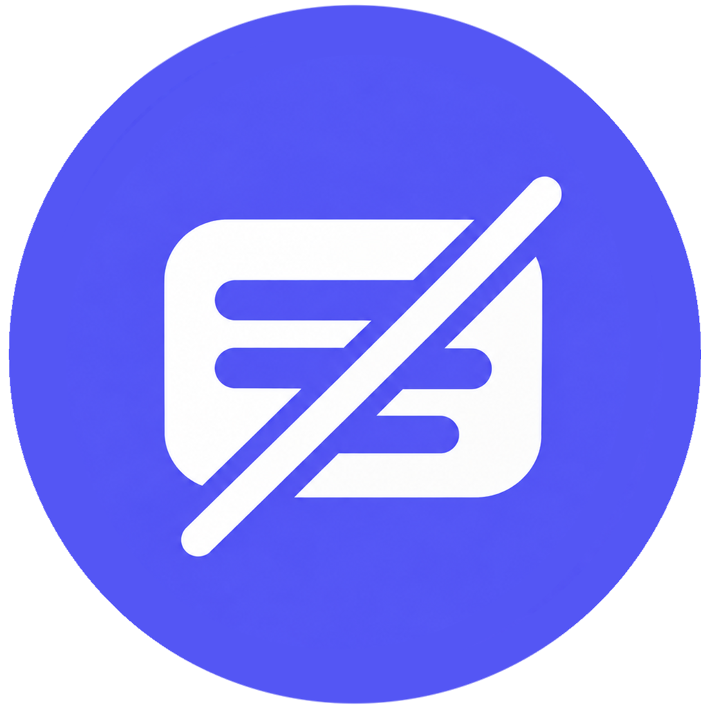
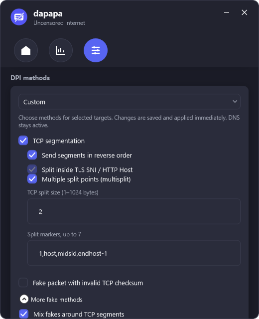

<div align="center">



# dapapa

**Lightweight DPI circumvention and encrypted DNS for Windows — per domain, without a VPN.**


</div>

---

## What is dapapa?

Some internet providers block websites by reading the name of the site inside your connection — a technique called **Deep Packet Inspection (DPI)**. dapapa slightly reshapes those first packets so the filter can no longer recognise the site name, while the real website still receives a perfectly normal connection. It also looks up the addresses of those sites through **encrypted DNS**, so the lookups cannot be read or tampered with.

- You choose which sites it applies to — everything else is left untouched.
- It is **not a VPN**: your IP address and internet speed stay the same, nothing is routed through another server.
- It runs quietly in the system tray and can start with Windows.

<p align="center">
  
  &nbsp;
  
  &nbsp;
  
</p>

## Quick start

1. Download `dapapa_Setup.exe` from the [Releases](../../releases/latest) page and install it. No .NET installation is required.
2. Start dapapa and accept the administrator prompt (needed by the network driver).
3. Go to **Settings → My targets → Add domain**, choose **Domain list** and paste your domains — one per line.
4. Press **CONNECT** on the home screen. Done.

If a site still does not open, see [Finding a working setup](#finding-a-working-setup).

### Example: Discord

Paste the list below into **Add domain → Domain list** and name the group `Discord`. Every subdomain is included automatically (for example `cdn.discordapp.com` and `gateway.discord.gg`).

```text
discord.com
discord.gg
discordapp.com
discordapp.net
discord.media
discordcdn.com
discord.dev
discord.new
discord.gift
discordstatus.com
dis.gd
```

If file uploads fail, also add Discord's upload storage host:

```text
discord-attachments-uploads-prd.storage.googleapis.com
```

After connecting, fully quit Discord (tray icon → **Quit Discord**) and reopen it, so it creates new connections.

> [!NOTE]
> This list is only an example of how to group domains. dapapa is not affiliated with or endorsed by Discord Inc. Make sure your use complies with the laws of your country.

---

## Detailed documentation

- [How it works](#how-it-works)
- [Targets](#targets)
- [DPI modes](#dpi-modes)
- [TCP methods](#tcp-methods)
- [Fake packet methods](#fake-packet-methods)
- [HTTP methods](#http-methods)
- [QUIC blocking](#quic-blocking)
- [UDP methods](#udp-methods)
- [DNS over HTTPS](#dns-over-https)
- [Statistics](#statistics)
- [Finding a working setup](#finding-a-working-setup)
- [Limitations](#limitations)
- [Building from source](#building-from-source)

### How it works

```
 Application ──► WinDivert ──► dapapa packet worker ──► Network
                    │
                    ├─ TCP 80/443 to target IPs  →  split / reorder / fake packets / HTTP header changes
                    ├─ UDP 53 for target domains →  local resolver (127.0.0.1:5300) → DNS over HTTPS
                    └─ UDP to target IPs         →  block QUIC or apply UDP methods
```

dapapa uses the [WinDivert](https://github.com/basil00/WinDivert) driver to capture only the packets it needs. For every captured TCP packet it reads the **TLS SNI** (the site name in an HTTPS handshake) or the **HTTP `Host` header**. Only when that name matches one of your targets is the packet modified; a shared IP address alone is never enough. Everything else passes through untouched.

Each packet is processed with a snapshot of the settings taken when processing begins, so changes apply to new packets immediately without reconnecting.

### Targets

| Topic | Behaviour |
| --- | --- |
| Adding | **Single domain** or **Domain list** (one domain or HTTP/HTTPS URL per line). Empty lines are skipped and duplicates removed. Up to 500 domains per group. If any line is invalid, nothing is saved. |
| Matching | A domain covers itself and all its subdomains: `example.com` matches `api.example.com`, but not `notexample.com` or `example.com.other.net`. |
| Groups | A list is saved as one group with one switch. The display name is optional (defaults to the first domain). Groups can be edited, deleted or searched; search also finds domains inside a group. |
| Live changes | Adding, editing, enabling or disabling a target applies to the running session. Removing the last enabled target stops protection. |
| Shortcuts | In multi-line fields, Enter adds a new line and Ctrl+Enter saves. |

#### Related domain discovery

When adding a domain you can enable **Find related domains** (off by default). The group is saved first, then the HTTPS home page of the first domain is downloaded and inspected:

- **Sources:** resource addresses (scripts, styles, images, preload links), redirects and Content-Security-Policy connection rules. Ordinary outgoing links are ignored. Relative URLs are resolved against the page and `<base>` address.
- **Limits:** at most 5 HTTPS redirects, 15 seconds in total, 2 MiB of decompressed HTML and 100 candidates. It never leaves HTTPS and always validates certificates.
- **Privacy:** resources are not downloaded, JavaScript is not executed, no login takes place. WebView2 is not required.
- **Result:** candidates start unselected. **Add selected** adds them to the same group. An HTTP `403`, a non-HTML response or a network error is reported as a failure; partial results are shown clearly.

Discovery cannot find every CDN, API or voice endpoint, and CSP entries are only *allowed* destinations — not proof that they are used. Advertising and analytics domains may also be suggested.

### DPI modes

| Mode | Behaviour |
| --- | --- |
| **Standard** | Splits the TLS ClientHello / HTTP request after 2 bytes into two TCP segments, sends the second segment first and blocks QUIC (UDP/443) to target IPs. This is the default. |
| **Custom** | Every method below can be enabled and tuned individually. Changes are saved and applied immediately. Switching back to Standard keeps your Custom selections. |

With every method turned off, dapapa still handles DNS for your target domains. Invalid Custom values never prevent switching back to Standard.

### TCP methods

| Option | Description |
| --- | --- |
| **TCP segmentation** | Splits the first data packet (TLS ClientHello or HTTP request) into two TCP segments. The byte stream the server receives is unchanged; only the packet boundaries move, so a filter that inspects single packets cannot see the whole site name. |
| **Send segments in reverse order** | Sends the second segment first (*disorder*). The server's TCP stack reassembles them, but many filters only look at the first packet they see. Off: segments are sent in order. |
| **Split inside TLS SNI / HTTP Host** | Moves the split point from byte 2 to the middle of the hostname, so the name itself is cut in two. |
| **TCP split size (1–1024 bytes)** | Position of the simple split. Default: 2. |
| **Multiple split points (multisplit)** | Splits at up to 7 positions (8 segments). With reverse order enabled it becomes *multidisorder*. Overrides the simple split size and hostname split. |
| **Split markers, up to 7** | Comma-separated positions for multisplit. Default: `2,host,midsld,endhost`. See the table below. |
| **Maximum payload (0 = no limit)** | TCP payloads larger than this value (1–65535) pass unchanged. DNS and QUIC handling are not affected. |

Split markers (each accepts a `+N` / `-N` offset, e.g. `endhost-1`; a plain negative number counts from the end of the packet):

| Marker | Position |
| --- | --- |
| `N` | Absolute byte offset in the payload |
| `host` / `midhost` / `endhost` | Start / middle / end of the hostname |
| `sld` / `midsld` / `endsld` | Start / middle / end of the second-level domain (`discord` in `cdn.discord.com`) |
| `sniext` | Start of the TLS SNI extension (TLS only) |
| `method` | Start of the HTTP method (HTTP only) |

Positions outside the packet or not present in the protocol are skipped, and duplicates are merged. If the full SNI cannot be read from a single TCP packet, the packet is left unchanged — packets are never reassembled. Packets carrying SYN, RST or URG flags, fragmented IPv4 packets and unsupported data are always passed through.

### Fake packet methods

A *fake* is a copy of the real first packet in which the hostname is replaced (by default every letter becomes `x`, e.g. `xxxxxxx.xxx`) and which is deliberately damaged so that **the real server discards it, but the filter in between accepts it**. The filter then "sees" a harmless site name and lets the real packets through. The real packets are never modified by these options.

Fakes are only sent when the hostname is readable and matches a target. Each enabled method produces its own separate fake.

| Option | How the fake is made invalid | Caveats |
| --- | --- | --- |
| **Fake packet with invalid TCP checksum** (`badsum`) | The TCP checksum is intentionally wrong. | Network cards or devices that correct checksums (offload) can make the fake valid and break the connection. |
| **Out-of-window SEQ/ACK** (`badseq`) | SEQ is shifted by `0x80000000` (half the sequence space) and ACK by `-66000`, placing the fake far outside the receive window. | The filter may also ignore out-of-window packets. |
| **Fixed low TTL** | Only the fake gets a TTL of 1–64 (default 2), so it expires before reaching the server. | If the server is closer than the TTL, the fake arrives and can break the connection. |
| **AutoTTL** | Estimates the hop count from the TTL of the server's SYN+ACK (assuming an initial TTL of 64, 128 or 255) and uses one less, capped at 20. | Skipped when there is no recent sample or the distance is 0–1 hop; no fallback to fixed TTL. Takes priority over fixed TTL. Asymmetric routes can make the estimate wrong. |
| **Invalid TCP MD5 signature** (`md5sig`) | Adds a fake TCP MD5 signature option, which servers without MD5 authentication reject. | Skipped if the TCP header is already longer than 40 bytes or the packet exceeds 1480 bytes. Some servers ignore the option. |
| **Old TCP timestamp** (`ts`) | Lowers the TCP timestamp value (TSval) by 600000, so PAWS protection drops the fake. | Skipped if the connection has no timestamp option. Windows settings are not changed. |
| **Without ACK** (`datanoack`) | Clears the ACK flag on the fake. | Some NAT devices drop such packets before they reach the filter. |

Additional fake options:

| Option | Description |
| --- | --- |
| **Randomize fake TLS random/session ID** | Fills the random and session ID fields of the fake ClientHello with random bytes, so the fake does not resemble the real handshake. |
| **Fake hostname template** | Uses your own hostname in the fake instead of `x` characters. It is padded or trimmed from the left to the exact length of the original name, so all TLS lengths stay valid. |
| **Repeats per fake type (1–6)** | Sends each fake 1–6 times. Real packets are never repeated. |
| **Mix fakes around TCP segments** (`fakedsplit` / `fakeddisorder`) | With TCP segmentation, each real segment is surrounded by fake segments before and after it. With reverse order it becomes *fakeddisorder*. At most 96 injections per original packet; when the limit is reached extra fakes are dropped, never real data. |

AutoTTL samples are matched to the exact client/server IP and port, kept for 60 seconds and limited to 1024 entries. Incoming SYN+ACK packets are only observed, never changed. Inbound SYN+ACK is not captured at all while AutoTTL is off.

### HTTP methods

These apply **only to plain HTTP on port 80** — HTTPS is never modified. They target complete `GET`, `POST` and `HEAD` requests; requests with a missing or duplicated `Host` header are left unchanged. None of them changes the length of the TCP stream, so no sequence/ACK translation is needed.

| Option | Example | Description |
| --- | --- | --- |
| **Host → hOsT** | `Host:` → `hOsT:` | Header names are case-insensitive for servers (RFC 9110) but naive filters may look for the exact text `Host:`. |
| **Mix hostname case** | `example.com` → `ExAmPlE.CoM` | Hostnames are case-insensitive; exact-match filters miss them. |
| **Remove the space after Host:** | `Host: a.com` → `Host:a.com ` | Moves the optional space to the end of the value. |
| **Extra space after HTTP method** (`methodspace`) | `GET /` → `GET  /` | Moves the Host space after the method. |
| **LF before HTTP method** (`methodeol`) | `GET /` → `\nGET /` | Moves the Host space in front of the method as a line feed. Methodspace wins if both are enabled. |
| **Use a tab after Host:** (`hosttab`) | `Host: a.com` → `Host:\ta.com` | Replaces the space with a TAB, if it was not already used by the options above. |

Some servers reject requests with extra spaces or line feeds.

### QUIC blocking

**Block QUIC for target IPs** drops outgoing UDP/443 traffic to target IP addresses. Browsers and apps then fall back to TCP/TLS, where the TCP methods above work. It is enabled in Standard mode and on by default in Custom.

Blocking is **IP-based**: other domains that share the same IP may also lose QUIC (they fall back to TCP as well). While blocking is on, UDP/443 packets are dropped before the UDP methods below run — turn it off to try QUIC methods.

### UDP methods

Available under **Custom → UDP methods**, all off by default.

| Option | Description |
| --- | --- |
| **UDP fake with invalid checksum** (`badsum`) | Sends a separate 64-zero-byte datagram with a non-zero, invalid UDP checksum before the real one. |
| **UDP fake with fixed low TTL** | Sends the same fake with a TTL of 1–64 so it expires before the server. There is no UDP AutoTTL. |
| **UDP fake repeats (1–6)** | Number of times each fake type is sent. The real datagram is never repeated. |
| **IPv4 fragmentation** (`ipfrag2`) | Splits the real datagram into two IP fragments. The first fragment's payload is 8–1440 bytes (a multiple of 8, includes the UDP header). Fragments share an ID, DF is cleared, MF/offset are set correctly and the UDP checksum covers the full datagram. Some networks drop fragments. |
| **Send IP fragments in reverse order** | Sends the second fragment first. |
| **QUIC Initial length padding** (`udplen`) | Appends 1–64 zero bytes to recognised QUIC v1/v2 Initial datagrams and updates the lengths and checksums. The encrypted QUIC packet itself is unchanged. Some QUIC implementations may reject it. |
| **First eligible packets per UDP flow (1–20)** | Only the first N matching datagrams of a flow are processed (default 3). A flow is reset after 60 seconds of silence. |

**Eligible protocols** decide which datagrams are processed: QUIC v1/v2 Initial (on by default), STUN, WireGuard handshake initiation, Discord voice IP discovery and *Other / unrecognised UDP*. The last option can include voice/RTP and may disrupt media.

Scope and safety rules:

- Only outgoing IPv4 traffic to target IPs is processed. IPv6, DNS (port 53), existing fragments, packets with IPv4 options or larger than 1500 bytes are passed through.
- QUIC headers (version, connection IDs, token, length) are validated, but QUIC is **not decrypted**, so matching is IP-based and may affect other domains on the same IP.
- Fakes are generic and are not valid QUIC/STUN/WireGuard handshakes.
- At most 1024 flows are tracked and at most 14 injections are made per datagram. Flows are cleared when targets or the session change.

### DNS over HTTPS

DNS queries for **your target domains only** are answered by dapapa:

1. Outgoing IPv4 UDP/53 queries matching a target are captured.
2. The query is passed through a separate socket to a local resolver on `127.0.0.1:5300` — the original packet is not redirected.
3. The resolver sends it as an RFC 8484 `application/dns-message` HTTPS POST to the selected provider.
4. The answer is returned as if it came from your original DNS server (same client, transaction ID, question and interface).

| Provider | Endpoint | Profile |
| --- | --- | --- |
| **Quad9 (ECS)** — default | `https://dns11.quad9.net/dns-query` | Threat blocking, ECS for better CDN selection |
| Quad9 | `https://dns.quad9.net/dns-query` | Threat blocking |
| Cloudflare | `https://1.1.1.1/dns-query` | Unfiltered |
| Google Public DNS | `https://dns.google/dns-query` | Unfiltered |
| AdGuard DNS | `https://dns.adguard-dns.com/dns-query` | Blocks ads and trackers |

- **Target IP resolution** (which IPs the TCP/UDP methods apply to) always uses Cloudflare DoH with a separate cache. Up to 8 domains are resolved in parallel and IPs are refreshed according to their TTL; failures are retried after 30 seconds. **Sync IPs** clears this cache manually.
- **Limits:** 4-second timeout, 8 active / 64 pending requests and 512 cache entries per DoH client. Identical queries are merged; TTL and HTTP `Age` are respected.
- **No plain-text fallback:** on error or overload the client receives `SERVFAIL`. dapapa never silently falls back to unencrypted DNS or another provider.
- Oversized replies are returned with the `TC` flag. TCP/53 is not captured, so such retries use the normal system DNS. Applications with their own DoH client bypass dapapa's resolver.
- Changing the provider while connected restarts the session cleanly and flushes the Windows DNS cache. Windows adapter DNS settings are never changed.
- No `hosts` entries are written. Leftover entries from old versions are removed on start and disconnect (a timestamped backup is created first; other entries are preserved).

### Statistics

- **Download / upload speed** and a live chart for the network adapter Windows uses to reach the internet. This includes traffic from all applications.
- **Bypassed packets:** packets modified by the selected methods.
- **Local DNS replies:** DNS queries answered over HTTPS.
- **DNS response time (DoH):** duration of a real DoH query to the selected provider. It is not a ping to Discord or any target. Failed or timed-out queries are not shown as successful.

### Finding a working setup

DPI implementations differ between providers and change over time, so no single profile works everywhere. A reasonable order to try:

1. **Standard** mode.
2. **Custom:** TCP segmentation + reverse order + *Split inside TLS SNI*.
3. Add **multisplit** with the default markers.
4. Add one fake method, starting with **badseq** or **AutoTTL**, then **badsum**. Enable only one at a time first.
5. Try **Mix fakes around TCP segments** and 2–3 repeats.
6. For voice or QUIC problems, turn off QUIC blocking and experiment with UDP methods.

Each time, restart the application you are testing so it opens new connections. *Protection active* only means the packet worker is running — it does not prove a site is reachable. If connections start failing, switch back to Standard.

### Limitations

- IPv4 only; IPv6 traffic passes through unchanged.
- ECH (Encrypted Client Hello), per-process filtering and TCP/53 DNS are not supported.
- TLS records are never rewritten and TCP packets are never reassembled.
- Already established connections are not reset when dapapa starts or exits.
- Closing the window hides dapapa in the tray; use **Exit** from the tray menu to quit. Forced termination (Task Manager, power loss) cannot guarantee cleanup.

---

## Building from source

Requires the [.NET 8 SDK](https://dotnet.microsoft.com/download/dotnet/8.0). [Inno Setup 6](https://jrsoftware.org/isinfo.php) is optional and only needed for the installer.

```powershell
git clone https://github.com/ouxan/dapapa.git
cd dapapa
dotnet build dapapa.csproj -c Release
```

Run the test suites:

```powershell
dotnet run --project Tests/dapapa.Tests.csproj -c Release
dotnet run --project Tests/Ui/dapapa.UiTests.csproj -c Release
```

Build the full release (tests → self-contained single-file publish → installer):

```powershell
.\build_setup.bat
```

Output is written to `artifacts\release` and `setup_output\dapapa_Setup.exe`.

<details>
<summary><b>Project structure</b></summary>

```
├── Dialogs/        Add-target, related-domain and sync result dialogs
├── Models/         Settings, DoH providers and DPI option models
├── Services/       Packet processing, DNS/DoH, WinDivert, hosts, tray, startup
├── Resources/      Icons and third-party licence notices
├── Tests/          Unit tests and WPF UI tests
├── windivert/      WinDivert 2.2 driver and library
├── installer.iss   Inno Setup script
└── build_setup.bat Release build script
```

</details>

## Data and privacy

- Settings: `%APPDATA%\dapapa\settings.json`
- Log: `%APPDATA%\dapapa\dapapa.log` (rotated at 2 MiB, three old logs kept)

dapapa has no telemetry. Network requests are limited to the selected DoH provider, Cloudflare DoH for target IP resolution and — only when you start it — related domain discovery for the site you entered.

## Acknowledgements

- [WinDivert](https://github.com/basil00/WinDivert) — packet capture and injection (LGPL-3.0)
- [AngleSharp](https://github.com/AngleSharp/AngleSharp) — HTML parsing for domain discovery (MIT)
- [GoodbyeDPI](https://github.com/ValdikSS/GoodbyeDPI) and [zapret](https://github.com/bol-van/zapret) — reference for DPI circumvention techniques; dapapa implements them independently and runs no external tools.

## Disclaimer

dapapa is intended for accessing information and services in accordance with the laws of your jurisdiction. You are responsible for how you use it. The software is provided "as is", without warranty of any kind. All product names and trademarks belong to their respective owners.

## License

Released under the [MIT License](LICENSE). Bundled third-party components keep their own licenses — see [THIRD-PARTY-NOTICES.md](THIRD-PARTY-NOTICES.md).
